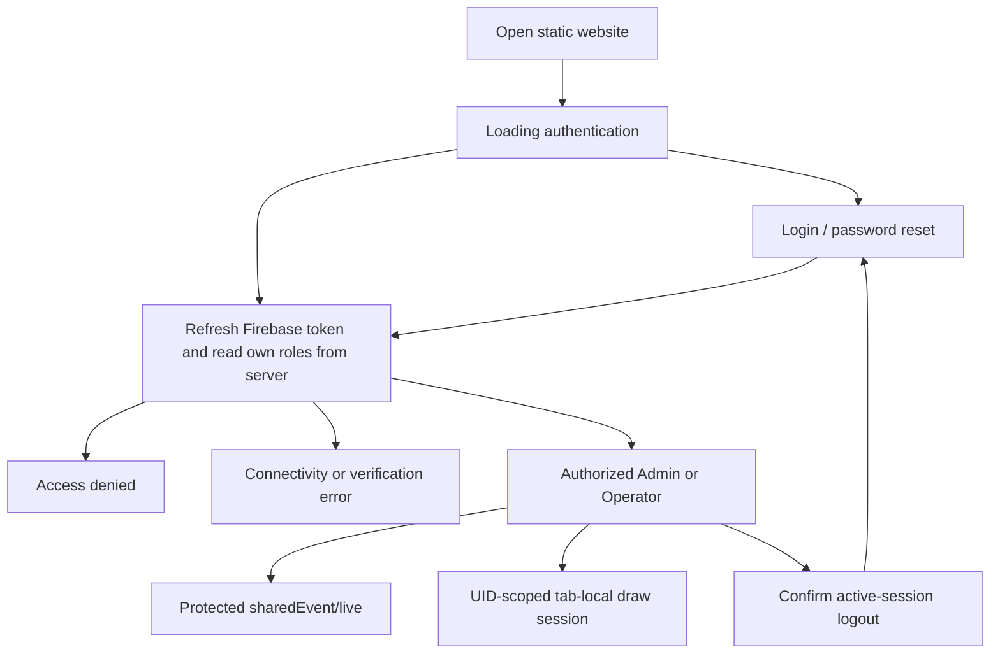

# Mandatory login and application roles — review candidate

This branch upgrades the existing Firebase integration. It does not create a project, change billing, provision production accounts, alter the current shared document, or deploy anything. Review this PR before approving a coordinated release. Project: `lucky-draw-quyet-thang`.

## Access architecture



`auth-guard.js` is the sole Firebase app/Auth initializer. It uses Firebase Auth state listeners, forced token refresh, server-only role reads, role listeners and a 60-second verification lease. SDK loading and server verification have a 15-second deadline; network requests cannot leave an old session authorized indefinitely. `index.html` initially renders only the branded auth surface: Dashboard has a native hidden/inert attribute from the initial response, and the private runtime is not initialized until verification succeeds. Runtime actions check the guard, and Dashboard event handlers refresh authorization before sensitive actions. Async file imports recheck identity after parsing so a previous account's file cannot reach a subsequent user's session.

States are loading, login, authorized, denied and verification error. Unknown accounts have no access. Offline startup never trusts a cached role. Offline/lost verification locks the runtime, stops audio/countdown rendering, drops in-memory private data and preserves persisted pending/committed draws. Reconnect verifies again before restoring the same owner's snapshot. Role changes stop configuration listeners; late responses cannot reopen a logged-out session.

The Firebase SDK restores existing sessions before deciding which screen to display. Remember Me is unchecked by default. Before sign-in, the selected checkbox sets browserLocalPersistence or browserSessionPersistence. No password, ID token or refresh token is serialized by application code. Standard username/current-password autocomplete remains, and password visibility and Enter submission are supported. Firebase's persistence and a browser's password manager are separate; this app does not control password-manager saving.

Forgot Password calls Firebase sendPasswordResetEmail, using the normal Firebase-hosted reset handler. The confirmation does not reveal account existence. Duplicate login/reset requests are blocked; credentials are cleared after sign-in attempts and on logout. No signup or role-selection UI exists.

## Roles and trusted administration

| Role | Dashboard / import / draw / exports | Read configuration | Publish settings | Provision roles |
| --- | --- | --- | --- | --- |
| Admin | Yes | Yes | Yes, revision transaction | Trusted Console/IAM channel only |
| Operator | Yes | Yes | No, no Save control | No |
| Authenticated without enabled role | No | No | No | No |
| Unauthenticated | No | No | No | No |

Keep existing `admins/<uid>` records. Add `operators/<uid>` only after the owner authorizes that account. Each document is `{enabled: boolean, validAfter?: integer epoch seconds}`; no user email/name/roster belongs there. Missing roles do not grant access; malformed or unexpected fields fail closed. Existing `{enabled:true}` Admin records remain valid. An Admin role wins when both roles are enabled. All clients, including Admins, are forbidden from creating, changing, deleting or listing role documents. Users can get only their own two role documents so access changes can be observed without exposing other identities.

Provision Auth users through the existing Firebase Console or a trusted IAM-authorized Admin SDK/CLI environment. Then set the appropriate role document using that trusted channel, never from this website. The app has no secure server-side account-management endpoint, so it intentionally offers no account creation or role editor. An application Admin role does not confer Google Cloud IAM access. Never commit UIDs, allowlists, passwords, service keys or tokens.

For immediate access removal, disable **both existing role memberships** before disabling/deleting the Auth account or revoking refresh tokens. For session-only revocation, retain approved membership but set its validAfter cutoff; the rules require token.auth_time strictly greater than that cutoff. Apply the cutoff to every enabled role. The user must sign out and sign in after the cutoff second; token refresh alone does not change auth_time. Firebase refresh-token revocation by itself does not immediately invalidate an already-issued ID token. Client listeners/periodic refresh complement, but do not replace, the server role/cutoff checks.

## Firestore audit and boundary

Rules now allow exact sharedEvent/live and legacy sharedTheme/live gets only to enabled, non-revoked Admin/Operator sessions. Only Admin can write, with the existing exact field schema, fixed allocation, revision +1 and request.time timestamp constraints. Legacy theme writes remain denied after sharedEvent exists. Configuration deletes, collection lists, role writes and all unrelated paths remain denied.

The existing public-read rules were correct for the former public-viewer requirement but cannot satisfy mandatory login. Merely hiding Dashboard would leave direct Firestore reads public. The candidate changes both layers. Queries remain exact document gets/listeners; no broad collection query is introduced.

Audit assessment for this candidate, subject to emulator evidence and human review:

```json
{"score":5,"summary":"Candidate uses trusted role documents, self-only metadata gets, protected configuration reads, identical create/update validation, bounded schemas, server timestamps and revision CAS. Production is unchanged and must be verified separately.","findings":[]}
```

GitHub Pages, repository code, logos and historical JSON archives remain public static assets. Existing archives contain the previously approved public defaults and are unchanged. They are only a pre-cutover migration seed after authorization; never put future protected settings or private data in them. New internal settings stay in Firestore. No browser guard can make already-public source files private or retroactively revoke a previously downloaded old client. A person with OS/DevTools access can inspect local storage; UID scoping is application account isolation, not disk encryption. Use separate OS/browser profiles on shared event equipment when stronger isolation is required.

## Private session compatibility

All new catalog, cache, draft, session and prize keys are namespaced `lucky-user:<encoded UID>:`. Runtime rosters/results remain sessionStorage, separate per tab; Remember Me persists authentication, not draw data across browser closure. Logout clears in-memory roster/results, file references, stage/reveal data and identity labels; it never deletes pending/committed snapshots. The same authorized UID restores its selected winners and original deadline after refresh or relogin. Another UID starts with its own session.

**Legacy unscoped sessions have no trustworthy owner identity.** They are preserved byte-for-byte but never automatically assigned to the first person who logs in. Do not upgrade a laptop in the middle of a real unscoped draw. Before release, the actual session owner must finish/export using the existing version, or arrange a supervised local recovery/mapping with the owner. This branch does not claim to infer legacy ownership or offer a self-claim button. Keeping the old records is non-destructive; owner-assisted migration remains a release prerequisite when such records exist.

## Approved release sequence (not executed by this PR)

1. Obtain owner approval, verify existing Admin membership schema, provision approved Operators through the trusted channel, and schedule a maintenance window with no live draw. Resolve legacy unscoped sessions before cutover. Preserve the current shared document and old rule release IDs.
2. Run the full tests and rehearse the new client with the final rules in emulators. Deploy final reviewed rules first and read them back exactly. Anonymous/old clients intentionally fail closed during this maintenance window.
3. Immediately merge/deploy the reviewed static client to Pages and wait for the exact SHA. With the final rules, the new client can get its own role documents and then read the existing shared document. An old cached client must be closed/reloaded. Do not restore public-read rules as an operational shortcut.
4. Verify fresh unauthenticated Firestore reads and writes are denied, Admin login/save works, Operator read/draw works but publish is denied, revocation works, and authenticated devices receive revisions. If sharedEvent is still absent, the first real Admin Save performs the existing JSON/theme migration; do not overwrite settings or initialize automatically.
5. Verify the public static endpoint, logo and synthetic 10-second batch. Verify a fresh browser profile, Remember Me across actual Chrome restart, password autofill and the physical event equipment before reporting the authenticated feature live.

A website deployment and a production Admin save are separate checks. The preceding settings release was deployed at 8f30f6f; first sharedEvent initialization was still pending when this branch began. This authentication PR does not complete that initialization or change production access.

References verified 2026-11-21: [Firebase persistence](https://firebase.google.com/docs/auth/web/auth-state-persistence), [user/password reset API](https://firebase.google.com/docs/auth/web/manage-users), [session revocation](https://firebase.google.com/docs/auth/admin/manage-sessions).
